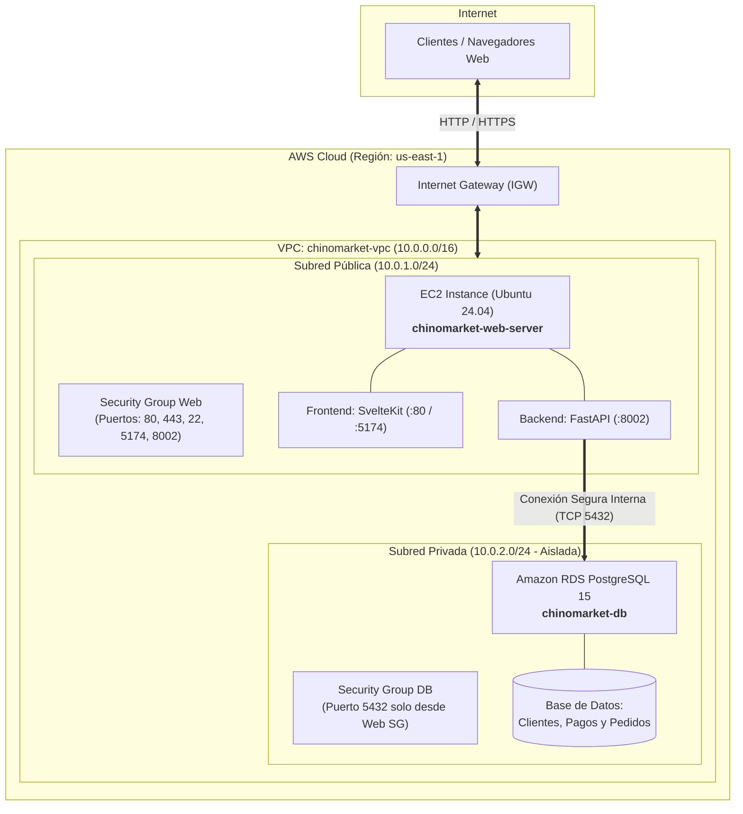

# 🏗️ Arquitectura Cloud en AWS — Chino Market (Grupo 1)

**Caso Asignado:** Tienda virtual con pagos y datos de clientes.

---

## 📌 1. Estado del Despliegue en AWS

* **Región:** `us-east-1` (N. Virginia - AWS Academy Lab)
* **VPC:** Creada con CIDR `10.0.0.0/16` (`chinomarket-vpc`)
* **Internet Gateway:** Creado y asociado (`chinomarket-igw`)
* **Subred Pública:** `10.0.1.0/24` (Zona `us-east-1a`) con ruta hacia Internet
* **Subredes Privadas:** `10.0.2.0/24` y `10.0.3.0/24` (Zonas `us-east-1a` y `us-east-1b`, Aislamiento total)
* **Security Groups:** 
  * `chinomarket-web-sg`: Puertos 80, 443, 22, 5174 y 8002 abiertos a Internet.
  * `chinomarket-db-sg`: Puerto 5432 **únicamente accesible desde el Web SG**.
* **Base de Datos:** Amazon RDS PostgreSQL 15 (`chinomarket-db.ch3ssj7dx551.us-east-1.rds.amazonaws.com`) en la subred privada.
* **Cómputo Web:** Instancia EC2 Ubuntu 24.04 (`chinomarket-web-server`) en la subred pública con IP `32.192.42.12`.

---

## 🗺️ 2. Diagrama de Arquitectura (2 Capas)

---

## 🔑 3. Archivos Generados en tu Proyecto
* [terraform/main.tf](file:///c:/Users/fabri/OneDrive/Escritorio/chinomarket2026/terraform/main.tf): Definición completa de la infraestructura como código.
* [terraform/variables.tf](file:///c:/Users/fabri/OneDrive/Escritorio/chinomarket2026/terraform/variables.tf): Parámetros configurables de la red y base de datos.
* [terraform/outputs.tf](file:///c:/Users/fabri/OneDrive/Escritorio/chinomarket2026/terraform/outputs.tf): Salidas con IPs públicas, endpoints y URLs de acceso.
* [PRESENTACION_SLIDES.md](file:///c:/Users/fabri/OneDrive/Escritorio/chinomarket2026/PRESENTACION_SLIDES.md): Guía detallada con el contenido exacto para las diapositivas 1, 2, 3 y 5.
